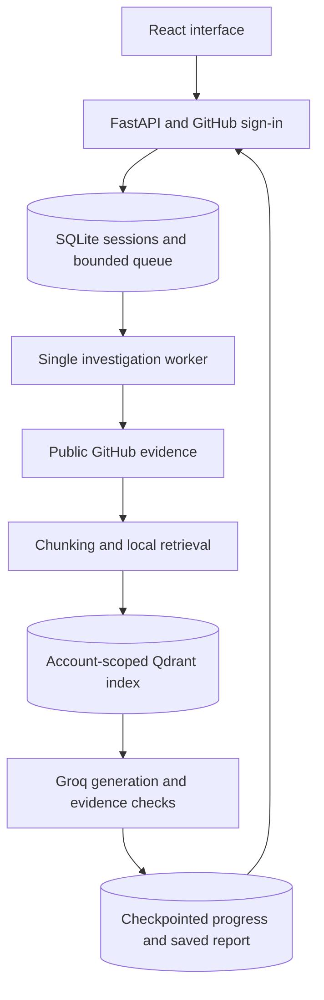

# Step 42: Case Studies and Resume

Prepared 7 November 2026. Target: AI engineering internships and junior LLM application roles. Start with the existing resume; the learning projects now provide additional evidence. This step remains in progress. Step 41 is checked off for roadmap tracking at Hassan's request, but public deployment is deferred.

## The Problem

A repository can contain useful engineering work while giving a visitor little help understanding it. A list of frameworks does not explain the problem solved, the decisions made, or whether the result was tested. This step turns the work into a case study a developer can inspect and a resume a recruiter can scan, with a traceable basis for each claim.

## Foundational Concepts

A **case study** explains one project through its problem, implementation choices, evidence, and limitations. Its reader should be able to follow one investigation through the system and understand why it was designed that way. It is a selective explanation, not a transcript of every development step.

A **resume** selects evidence relevant to a particular position. For an LLM application role, retrieval, tool use, validation, evaluation, and recovery are relevant examples. The same person can also have web-development experience; that experience demonstrates the ability to build interfaces, APIs, and usable applications. Choosing the emphasis does not require deleting that background.

An **evidence trail** connects a statement to the material behind it:

```text
Resume bullet -> project case study -> implementation or recorded result
```

The strength of a statement must match its evidence. An implemented check, a successful local demo, a benchmark result, and observations from real public users establish different things. A Docker build establishes packaging compatibility for that build environment; it does not establish a successful public deployment.

## 42.1 Architecture Write-Up Structure

A reader cannot evaluate an architecture without knowing what the system is meant to accomplish. Begin with the user and task, then explain the design through the path that produces an answer. Reserve component details for the decisions they help explain.

For WhyTheDiff, a useful opening is: "A developer asks why a public repository changed. The app inspects code and history, then returns an explanation with inspectable sources and explicit uncertainty."

Use this order for the write-up:

1. Problem, intended user, scope, and current status.
2. One representative question and the output contract.
3. Request flow, state storage, and external dependencies.
4. Two or three consequential decisions, including alternatives.
5. Evaluation, failure examples, and operational limits.
6. Links to the code, recorded demonstration, and reproduction instructions.

An architecture diagram should distinguish computation, external services, and saved state:



This is a conceptual flow, not a claim that each box is a separate server. The current deployment design keeps the API, worker, and persistent stores on one machine. The provider serves generation remotely; embedding and reranking models run locally by default.

Explain a decision with its consequence. For example: SQLite and embedded Qdrant make the single-server setup self-contained, but require durable disk and constrain replication. The one-active-investigation policy limits simultaneous work and resource use, while introducing queueing. Those trade-offs are more informative than calling the architecture "scalable."

Use an architecture write-up when the reviewer needs to judge boundaries and decisions. Use the README for the shorter entry point and setup instructions. [GitHub's README guidance](https://docs.github.com/en/repositories/managing-your-repositorys-settings-and-features/customizing-your-repository/about-readmes) helps distinguish that entry point from supporting documentation.

## 42.2 Leading With Evaluation Numbers

A fluent answer can still have bad citations. A retrieval score can improve while generation remains unreliable. An **evaluation metric** measures a defined behavior on a defined set of inputs; it is not a general quality certificate.

First identify which question the metric answers:

| Measure | What it can establish | What it does not establish alone |
|---|---|---|
| Retrieval recall at k | Whether labelled relevant evidence appeared among retrieved results | Whether the final answer is correct |
| Citation validation | Whether the referenced source and quoted text exist | Whether the quote entails the claim |
| Model-judged faithfulness | How a configured judge assesses support in supplied contexts | Independent factual truth or universal accuracy |
| End-to-end task acceptance | Whether the stated task criteria were met | Reliability on different repositories or workloads |
| Unit tests | Whether the tested contracts and edge cases behave as expected | Answer quality on unseen questions |

Compare a **baseline**, a simpler reference method, with the candidate on the same cases and conditions. Keep model settings, source snapshots, and acceptance criteria explicit. Include failures and retries in the accounting. Inspect individual outputs as well as aggregates; an agent may reach the right final answer through an invalid or excessively costly path. [Anthropic's agent evaluation guide](https://www.anthropic.com/research/demystifying-evals-for-ai-agents) discusses these evaluation distinctions and the need to inspect trajectories.

For each reported number, preserve this record:

```text
Metric and denominator:
Inputs and labels:
Baseline and candidate:
Source snapshot, code revision, model configuration:
Command and saved output:
Date and environment:
Failures, exclusions, and known limitations:
```

WhyTheDiff already has a useful example. In the historical three-case evaluation, CT-002's baseline failed citation validation while the investigation passed it. The baseline took 20.951 seconds and one model call; the investigation took 74.097 seconds and seven calls. This supports a specific observation about one case and its cost, not a claim of universal improvement. See [the recorded evaluation](../PROJECTS/Project-4-WhyTheDiff/docs/architecture.md#evaluation-as-recorded-16-october-2026).

The later Ragas table scores those older reports against reconstructed cited-source contexts. It has two comparable cases, with CT-003 marked not applicable. It must not be described as a fresh evaluation of the latest pipeline or converted into "90% accuracy." See [the scoring limits](../PROJECTS/Project-4-WhyTheDiff/docs/faithfulness-results.md).

**Absolute and relative change differ.** In a hypothetical test, 60% to 75% is a gain of 15 percentage points, or 25% relative to the original score. Always state which is meant. With very few cases, report counts and case-level outcomes so the reader can see the sample size. Do not invent latency percentiles from one run or treat repeated model judgments as new independent user tasks.

Lead with a number when it materially describes the result and can be explained in a short qualification. Otherwise lead with a specific capability and put the detailed benchmark in the case study.

## 42.3 Resume Bullet Rewrite

"Used LangGraph and Qdrant" describes dependencies. A useful bullet explains what was built and why the implementation matters. A **resume bullet** compresses one defensible contribution into a short statement.

A working pattern is **action + system or behavior + relevant mechanism + supported outcome**. The outcome can be a demonstrated capability rather than invented revenue, users, or efficiency gains.

For example:

> Built a repository investigation app with LangGraph and Qdrant that traces public GitHub code changes and returns source-linked explanations with explicit uncertainty labels.

A second bullet can expose a different engineering concern:

> Implemented GitHub OAuth, account-isolated histories, a bounded investigation queue, and checkpoint-based recovery in a FastAPI application.

These bullets state implemented behavior. They do not claim public hosting, customer adoption, or immunity to prompt injection. Choose two complementary bullets instead of repeating the same feature in different words.

For an internship, describe your work rather than assigning the team's entire product to yourself. For freelance work, distinguish the scope you delivered from the client's broader business. Terms such as "enterprise-grade" and "production-grade" should be replaced by concrete controls and verified operating conditions.

[Harvard's resume guidance](https://careerservices.fas.harvard.edu/resources/create-a-strong-resume/) supports specific, active, fact-based language and tailoring to the position. AI can help edit a bullet, but the author must verify both the factual claim and the implication a reader would draw from it.

Use a metric-bearing bullet when you can explain its measurement and scope in an interview. Use a behavior-based bullet when no appropriate measured improvement exists.

## 42.4 Selecting Projects for the Target Role

A resume has limited space. Pick projects by the evidence they add, rather than including everything chronologically. A **role-to-evidence map** connects requirements to examples you can discuss.

| Evidence relevant to LLM application work | Candidate example in this course |
|---|---|
| Retrieval and structured data access | Eight-Thousanders RAG Assistant |
| Evaluation and ranking metrics | Project 2's labelled retrieval evaluation harness |
| Tool execution, memory, and recovery | Research Briefing Agent |
| Evidence validation and agent orchestration | WhyTheDiff |
| Product interface and backend integration | FastAPI/React project surfaces and prior web work |

The initial AI-focused resume can feature WhyTheDiff, Project 2, and Project 3. A product-oriented application might instead select the Doorman game or a client project if its evidence better matches that position. Avoid crowding one page with seven similar project descriptions.

Keep work experience visible. An internship or client handoff can show collaboration and delivery that course projects cannot. Technical skills should name tools you can explain and use; a completed module is learning progress, not professional employment.

[MIT's resume guidance](https://capd.mit.edu/channels/resumes/) treats the resume as evidence of qualifications. Its [communication lab guide](https://mitcommlab.mit.edu/aeroastro/commkit/resumes-and-cvs/) also emphasizes selecting material for the intended reader and making contributions concrete.

## 42.5 Reproducible Proof and Honest Status

A reader needs a practical way to verify the story. A **proof package** provides a working repository entry point, a representative run, results, and limitations. A public URL is useful evidence only when the application is actually hosted and works there.

For a project that is currently local, publish a short recording and setup instructions. Show a complete successful example and an informative failure or abstention. Keep the question, output, and citations legible. Record the version used; do not present a historical recording as proof of the current release.

For WhyTheDiff, use the exact status: **implemented locally and Docker-packaged; public hosting deferred after Oracle A1 capacity failures**. A Resource Manager stack being "Active" means the configuration is saved, not that the app is live. Public HTTPS, host persistence, and production OAuth checks remain unverified.

Before making evidence public, remove credentials, private questions, session cookies, and personal account data. Keep links consistent: the resume should lead to the correct repository and the project page should explain the same project. A GitHub source link and a live demo link are different things.

The external curriculum's [career practice guide](https://github.com/rohitg00/ai-engineering-from-scratch/blob/main/learning-paths/CAREER-PRACTICE.md) was cross-checked as the closest matching career material; a dedicated resume lesson was not identified. Its useful addition is to preserve reviewable evidence and distinguish local tests, simulations, and public operating results. Completing a portfolio is not equivalent to professional production experience.

Use a live demo when it is maintained and safe to expose. Use a recorded run with a truthful local status when hosting is pending.

## 42.6 Structure and Readable Exports

A strong project can be missed if dates, headings, and links are hard to locate. An **applicant tracking system (ATS)** may extract resume content for an employer's workflow. Its behavior varies; there is no universal passing keyword score.

For this early-career draft, aim for one readable page containing contact links, work experience, selected projects, relevant skills, and education. Treat one page as a design target rather than an excuse to shrink text beyond comfortable reading. A summary is optional; a short, accurate headline can be enough.

Use ordinary section names, real text, consistent dates, and clear link labels. Avoid conveying essential facts through icons, decorative graphics, or skill-rating bars. Use the terminology of a position only when it accurately describes your experience. Hidden text and keyword repetition provide no additional evidence of competence.

Export to the requested format, then inspect the actual file. Check page breaks, text selection, reading order, contact links, and whether text is clipped. A PDF that looks correct can still contain awkward text extraction; a Word file can reflow on another system. Keep an editable source and verify each exported version. [MIT's checklist](https://capd.mit.edu/resources/resume-checklist/) is a useful final review aid.

Use a simple layout when communicating factual qualifications is the priority. Put richer screenshots and architecture diagrams in the portfolio, where there is room to explain them.

## 42.7 Ownership and Interview Explanation

A resume creates questions you should be prepared to answer. **Ownership** means knowing what you implemented or directed, what the libraries handle, how you verified it, and where your understanding or evidence is incomplete.

Practice a two-minute explanation: state the task, follow one request through the system, explain a consequential decision, show a result, then name a limitation and the next experiment. Be ready to expand on the actual code after that overview.

For WhyTheDiff, useful questions include: Why use a bounded queue? Where does an account's data live? How does citation matching differ from judging whether a quote supports a claim? What happens when a worker is killed? Why did the agent use more calls than the baseline? How does a hosted restart affect SQLite and Qdrant?

AI-assisted development can be discussed precisely: describe how tasks were scoped, which decisions you made, what you reviewed, and what you tested yourself. Do not claim you independently designed every generated line, or imply that a framework's internal implementation was written by you.

Use the case study to prepare explanations, not just to decorate the portfolio. If a bullet cannot survive a technical follow-up, narrow it or study the underlying implementation before publishing it.

## Pitfalls

| Failure | How to notice and correct it |
|---|---|
| A build plan is quoted as completed work | Check the implementation and recorded results, not just STEPS.md |
| "Accuracy" is used for every score | Identify the metric's actual definition, inputs, and denominator |
| One favorable result becomes a broad claim | Report the sample size, failures, and task scope |
| Test counts stand in for answer quality | Separate contract tests from retrieval and answer evaluations |
| Local success becomes "deployed" | Give the environment and the actual available URL, if any |
| Headline implies a role never held | Separate target role, demonstrated skills, and employment titles |
| Dates remain stale | Confirm finished internships and expected graduation explicitly |
| All projects repeat the same evidence | Choose complementary examples and keep the rest in the portfolio |
| A screenshot contains private data | Review the exact image and recording before publication |
| Formatting is approved from source text alone | Open and inspect the exported document before distributing it |

## Quick Reference

| Artifact | Reader's question | What belongs there |
|---|---|---|
| Resume | Why consider this candidate? | Selected contributions, relevant skills, dates, and links |
| Case study | How was this system designed and assessed? | Problem, flow, decisions, results, and limitations |
| README | How do I understand and run this project? | Status, scope, setup, and supporting links |
| Evaluation record | Can this number be checked? | Inputs, conditions, command, outputs, and exclusions |
| Demo | What happens when someone uses it? | One complete task and a visible boundary or failure |

## Theory Summary

A portfolio is a set of claims with evidence at different levels of detail. The resume selects what matters for a role; the case study explains the reasoning; the repository and evaluation records allow verification. Precision includes limitations: a small experiment is useful when its scope is clear. Your strongest story is the work you can explain and demonstrate.

## Deliverable

**Named artifact:** [Step42-Portfolio-Evidence.md](Step42-Portfolio-Evidence.md), a reviewable WhyTheDiff case study and evidence-backed project bullets. It is the first working artifact for this step; it is not a claim that the full resume, site, or deployment is finished.

Work through this sequence one part at a time:

1. Explain the WhyTheDiff architecture and decisions in your own words; correct the case study where necessary.
2. Trace each proposed result to its source and review the metric limitations.
3. Review the AI-focused resume draft and verify employment dates and project ownership.
4. Format the agreed content into the final resume and inspect its export.
5. Reuse the case study in the portfolio; keep project status and links consistent.

Personal resume drafts and contact details stay outside the public course repository. Commit the public evidence artifact once reviewed. Mark Step 42 done after the case study and resume are actually usable, not just because these notes exist.
